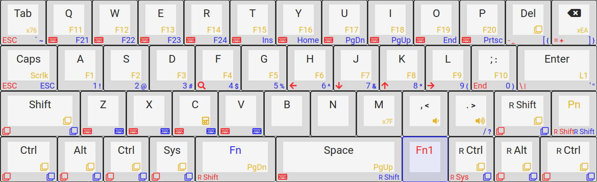
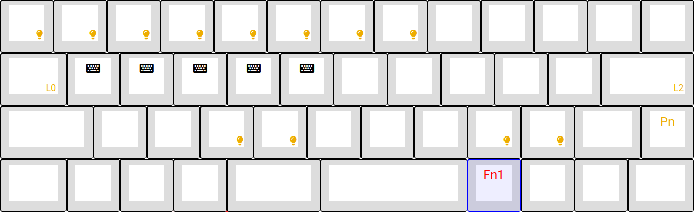

# keyboard

keyboard configuration for a Vortex Core 40%, generated using [TsFreddie's MPC
tool](https://tsdo.in/much-programming-core/).

note: this is assuming `Caps lock` is remapped to `Esc` on press and `Ctrl` on
hold (e.g. using `caps2esc`).

## layer 0

macros are mainly used for shift, ctrl & alt modifiers.

## layer 1

lighting configuration layer with some macros for workspaces.

